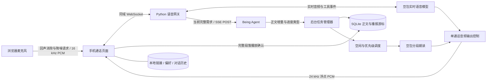
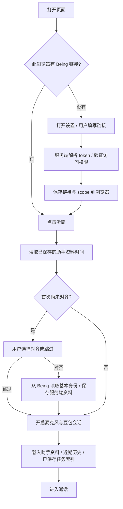
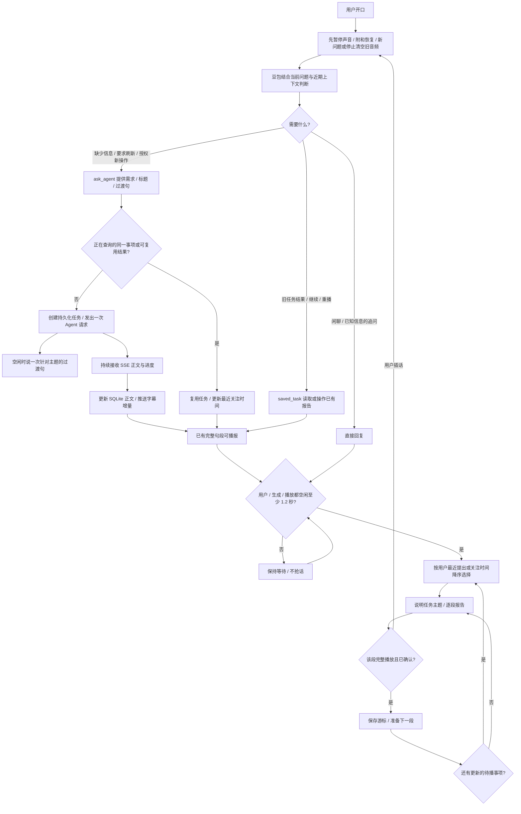
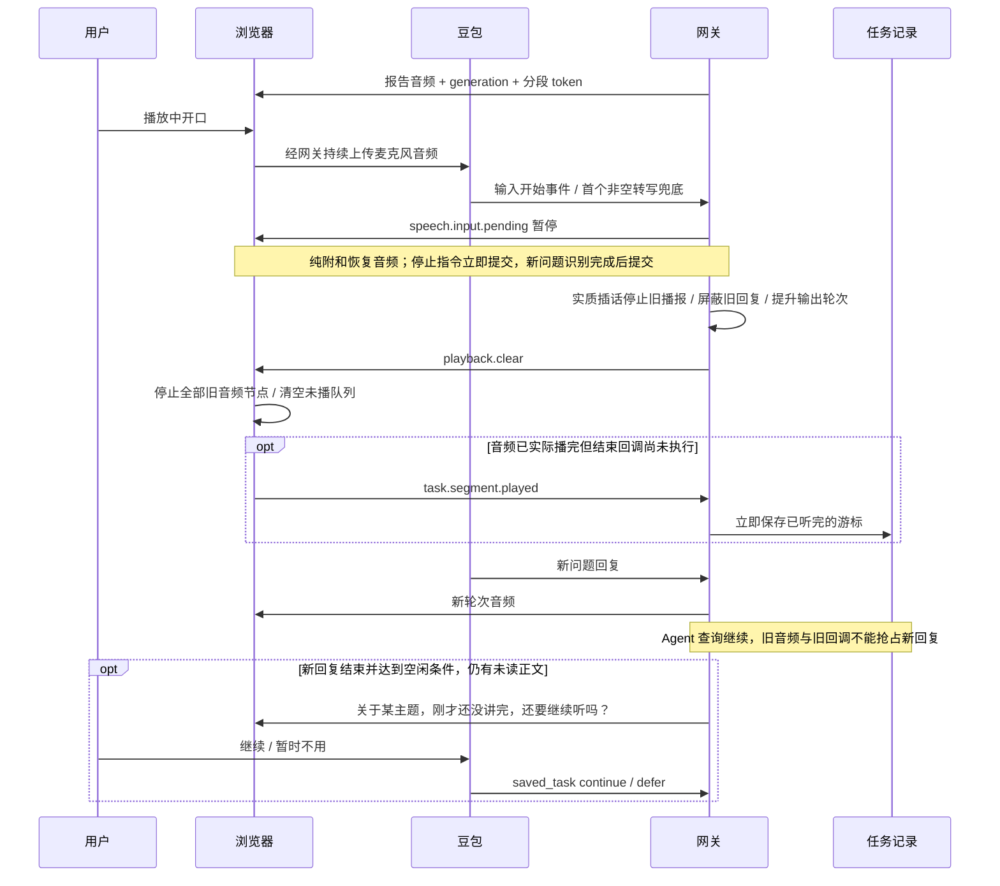

# Being 语音通话流程与状态

本文描述本目录代码的实际行为。网页是通话客户端；豆包负责实时语音理解与直接回复；Being 处理需要外部信息或实际操作的请求；网关持久化任务并安排播报。当前没有另一个本地意图识别模型。

## GPT-Live 可选路径

以下原有章节描述默认豆包模式。浏览器设置选择 GPT-Live 后，沿用链接验证、助手资料、历史缓存和同一任务库，语音传输改为 Live 主 WebSocket；桌面原生语音入口仍使用豆包。

用户插话清空浏览器播放队列并暂停报告，查询持续运行；新音频在检测到静音边界后恢复。Live 的主音频事件没有回复 ID 和结束事件，此边界是应用侧估计，真实打断仍需验证。旧任务只恢复数据，不在接通时逐条朗读或重复提交。旧报告有结果时，在空闲且已开始本轮交流后最多自动询问一次；用户可说“继续报告”或“重播报告”。

Live 可改述后台内容，因此 `commentary.appended` 只作为上下文接收确认，不能当作精确朗读游标。任务全文持久保存，Live 保持会话内交付位置，打断的片段可重复，重连从已有精确游标重新读取。挂断时发 `session.close`，最多等 8 秒接收最终用量；即使没收到也结束本地通话，并记录用量尚未最终确认。

需要本地转接时，只有“语音网关 ↔ GPT-Live”的加密连接经过 SSH 反向隧道和本机 `openai_local_relay.py`。浏览器、Being 查询、任务数据库及豆包仍走原云端链路。本机不读取 OpenAI Key、不解密语音，隧道两端仅监听回环地址。

## 简短预览与分步反馈

豆包自动报告先播最多两段有声正文、合计最多 180 个原文字符；这是已返回正文的短预览，不是另一模型生成的摘要。到达预算后保留全文和准确播放游标，等待用户明确要求继续或重播，不自动长篇读完或反复询问。显式继续/重播仍支持完整报告。预算在本次连接的流式等待与重新调度之间保留。

网关请求 Being 先输出已核实的简短结论或可执行的第一步，再补充细节；不增加操作授权，不输出内部推理，也不把工具运行本身说成已有结论。真正分步返回取决于 Being 的上游流式输出；网关不会在未收到正文时编造答案。自动报告先准备可用首段音频，再说返回提示，避免提示后仍等待首段合成。

播放回执先于插话提交完整游标时，报告保持已读完；取消或音频异常不会把已确认读完的正文改回暂停。仍未确认播放的片段保留原游标，允许显式继续。

当前提问仍有效时，首个可用事实或完整结果通过真实工具回执交给豆包组织两三句话回答，不必等整个后台任务结束。每轮最多一个自然结果；后续新增正文完成时，空闲后最多补充一句新的实质内容，不重复全文。改述不代表原文逐字播放，游标保持原位置，全文继续保存；显式继续可读取原报告。原轮次已被新问题替代或自然回复超时，则降级为短预览，屏蔽迟到的旧回复，避免双重播报。

豆包网页在浏览器明确报告回声消除已启用时，持续较强输入 300ms 可暂时暂停播放器并保存音频偏移，麦克风仍上传。服务端 ASR 开始先发暂停信号；纯“嗯、对、好的”等附和恢复剩余音频，明确停止命令立即清空旧音频，新问题在识别完成后优先接入。暂停期间不确认未听完的报告。本地猜测最多暂停 1.2 秒；远端确认输入后保持暂停至识别结果或失败，期间新增音频仅缓存，不因停顿恢复。缓存有上限，远端确认后超过上限结束通话，避免恢复旧声音压住用户。后台查询不因暂停取消。

本地能量判断不是语义 VAD，外放残留回声或噪音可能误触，低声输入可能漏检。附和恢复只能续播网页已经收到的音频；若上游自动取消，尚未下发的普通豆包回答尾部无法直接恢复。手机外放、耳机和噪声场景仍需验收。GPT-Live 不启用这套豆包输入处理，其既有音频缓冲修复保留。

## 组件与数据流

“单通话音频输出控制”指一个 WebSocket 会话只保留一个声音来源。不同终端同时通话仍有各自的播放器；当前没有跨终端全局声音互斥。

## 首次设置和连接

每个控制连接均验证用户链接。普通重连只读取已保存资料，不自动向 Being 发出新的资料查询；“更新助手信息”才请求更新。用户首次主动对齐也属于显式更新。资料保存在服务端、按 scope 隔离；完整文字历史保存在浏览器。

任务索引与当前续播对象随 `session.create` 一次载入。观察器首轮恢复所有历史任务的状态基线，只向网页恢复数据，不逐条对豆包执行 `session.update`。通话中的报告控制变化经过去重、合并，等待首轮交流结束及输入/生成/播放空闲后再同步；“正在询问续播”到“等待选择”不重复刷新提示词。正文和游标仍持续保存，不依赖提示词是否更新。

## 每轮问题与后台任务

图中的循环在正文读完时结束；流仍在运行但暂无完整句段时，报告进入 `waiting`，释放输出等待新内容。用户最新问题的直接回复优先于待播任务；旧任务仅在句子已确认播放的边界给更新的待播任务让位。实质插话停播，不等句末；纯附和恢复原音频。

当前去重是同一 scope 下的规范化问题匹配，不是任意语义近似识别：在途重复请求复用同一任务；通用任务列表查询成功后有约 60 秒复用窗口。不同项目、时间、过滤条件或新操作不能合并。模型先判断是否真需要查询，网关再做确定性的去重。

## 两套独立状态

任务“请求进展”和“播报进展”分开保存；停止播报不等于取消查询。

| 字段 | 状态 | 含义 |
| --- | --- | --- |
| `state` | `running` | Agent 请求仍在执行或等待 |
| `state` | `completed` | 本次查询正常结束并收到正文；不代表外部业务任务已经完成 |
| `state` | `error` | 出错、超时或无可用正文；部分文本仍保留 |
| `state` | `interrupted` | 服务退出/重启或 Agent 明确因新消息让位导致请求中断，不自动重提交 |
| `delivery` | `waiting` | 等待文本或在句末让位后等待恢复 |
| `delivery` | `pending` | 已安排报告，等待可用交流时机 |
| `delivery` | `reporting` | 正在逐段播报 |
| `delivery` | `paused` | 被打断或音频失败，保留游标 |
| `delivery` | `asking` / `awaiting_choice` | 正在询问续播 / 短回答或预览后等待明确继续 |
| `delivery` | `reported` | 已收到正文全部确认播完 |
| `delivery` | `deferred` | 用户选择暂不报告，全文仍可重复读取 |

任务还保存 `id`、原请求 `request`、短标题 `title`、完整 `text`、已播放字符位置 `cursor`、创建时间、更新时间和 `requested_at`。只有用户提出、追问或要求重播才更新 `requested_at`；Agent 晚返回不能自动提升优先级。新失败额外保存安全的 `error_code` 和 `error_message`，不含请求链接、token 或原始异常文本；旧记录没有具体原因时不推测补写。

## 打断、末尾抢接与续播

客户端按 AudioContext 播放时钟确认完整段落；网关确认处理时立即保存游标，并为迟到确认保留 3 秒窗口。确认必须属于本次播放尝试；重播之后旧 token 不能推进新的游标。半句被打断会从该段开头重读，避免漏信息；只有报告具有这种精确续播机制，普通豆包聊天没有同样的报告游标。

当前没有本地语义 VAD 或声纹判断；附和过滤使用服务端最终转写的保守文本规则。回声消除、降噪由浏览器请求设备提供；设备、背景人声与网络会影响实际效果。

## SSE、进度和上下文边界

- Agent 的 SSE 按 `scene_id` 和 `stream_id` 归属过滤，使用事件 ID 去重；浏览器按增量 offset 去重。只显示关联任务的回复。
- 接到多少正文就保存、显示多少；报告按完整句段朗读，最长分段约 160 字，只预合成下一段。自然回复路径使用上述短回答策略，降级及显式继续路径保留逐段朗读。
- HTTP 202 表示已接收并排队，不重新 POST；使用历史序号 cursor 查询后续关联回复。预读 cursor 超时不判失败，先取最新历史窗口并按唯一 `scene_id` 匹配，之后推进 cursor；历史读取短暂失败继续等待。仍可能等到对应历史消息可用后才收到内容，不能把这条降级路径等同于实时 SSE 增量。
- SSE 中只有思考或工具事件、没有正文的 `message_stop` 继续等待；流结束且尚无正文时查询同一场景的历史。明确的上游让位标记记录为 `interrupted`；部分正文后连接异常保留已收到内容并标记失败，不再从历史追加整段造成重复。
- thinking 和工具调用转换成“分析中、调用工具、生成中”等进度类型；不向浏览器发送隐藏思考正文或工具参数。
- 浏览器完整文字历史留在 IndexedDB。豆包启动使用约 24000 字的近期窗口、已保存资料和最近任务索引；Being 收到的 `message` 只有补全必要指代后的当前需求，不粘贴整个通话记录。
- 后台请求最长约 600 秒，无进展约 300 秒后结束等待并保留已收到内容。网页断开不取消服务端查询；服务进程退出仍会中断运行中的请求。
- 当前界面隐藏后台任务面板，但状态、全文读取与续播协议仍保留。用户可以通过语音 `saved_task` 反复获取已有结果。

## 结束通话

用户明确告别触发 `end_call`：播完简短告别后关闭当前通话。用户主动挂断、页面进入后台/锁屏、传输持续拥堵也会结束客户端通话。没有后台任务、生成、输入或播放且持续空闲 30 秒时自动结束；后台查询结果仍由任务管理器保存。

## 代码入口

| 职责 | 文件 |
| --- | --- |
| 网页、麦克风、播放确认、本地缓存 | `mobile/index.html`、`mobile/call.js` |
| 独立网站入口 / 原网关入口 | `serve.py` / `doubao_server.py` |
| 模型、系统指令与三类工具 | `doubao_config.py` |
| 链接验证与 SSE 适配 | `agent_endpoint.py`、`agent_bridge.py` |
| 请求生命周期与持久化 | `background_tasks.py`、`task_store.py` |
| 报告续播与优先级 | `task_reports.py`、`turn_scheduler.py` |
| 初始任务上下文与后续状态合并 | `task_context.py` |
| 音频来源互斥与旧事件过滤 | `speech_output.py` |
| 助手身份 / 历史窗口 / 数值用量 | `doubao_profile.py`、`conversation_memory.py`、`voice_usage.py` |

### 任务进度与上下文（Mac / 豆包）

`BackgroundTasks` 持久化安全阶段、阶段更新时间及终态原文摘录。完整正文和播放游标仍独立保存；阶段不是查询结论，查询完成也不代表外部业务操作成功。摘要最多240字，是带标签的源文本摘录。

`TaskContextSync` 提供最多12条任务卡片，运行任务优先，并附运行总数；最新阶段、终态和报告控制变化在语音空闲后合并更新。正文分片和游标变化不反复更新提示词。豆包启动及刷新使用最多12000字近期对话，完整界面历史不删。更新任务快照不等于物理删除供应商会话内已有历史；较早任务通过 `saved_task list/get` 检索。

`TaskProgress` 不朗读 thinking/tool 等技术阶段。界面持续显示最新阶段；无正文查询等待45秒后，空闲时最多提醒一次。多个符合条件的任务合成一句，最多点名两项，其余计数；全局至少间隔60秒。结果和用户请求优先于进度。新一轮用户输入、正文返回或排队超过15秒会使旧进度失效，不积压补读。只描述已观察到的状态，不概括内部思考、不编造业务进展。

Mac 通话面板按任务ID显示阶段与终态。任务事件独立于当前对话和音频世代处理；迟到进度不能将终态改回运行，恢复历史不触发朗读。

播放阶段的中断会立即释放旧调度锁，但保留新一轮用户输入/生成状态；不再等待旧播报的空闲条件来解锁。进度短句已经发送首帧后，单纯从accepted变thinking不清除在播队列；用户打断、明确暂不播报或正文到达仍使旧进度失效。

Mac 默认只展示最多3项运行任务；不展示历史任务列表。首次连接只跟踪运行中及本次连接新建任务，不重放旧任务正文、完成通知或错误。IndexedDB 中完整任务正文保留，但这类 `scope:agent:<id>` 记录不再重复作为语音助手说过的话注入近期对话；任务索引和 `saved_task` 负责提供结果上下文。

Mac 对话恢复通过 scope-at 索引倒序读取，最多扫描512个键、加载48条对话和24000字；任务正文记录在读取值之前跳过。原始存储保留，旧结果按需查询。业务待办查询与本地查询执行状态分开处理，历史 upstream_interrupted 不代表新查询不可用。

任务路由：前台自主选择 ask_agent.operation=create/read/requery；read 和 requery 携带 existing_task_id。新建和重查携带 intent；网关从工具 call_id 生成 request_id，兼容调用方显式传入（kind、subject、goal、time_range、conditions）。任务卡片同步 intent，前台先关联运行中的已有任务，后端对完整结构化意图相同的运行查询复用；不会按正文、标题、同义词替换或模糊相似度自动合并。条件或时间不同保持独立。
request_id 在 SQLite task_requests 中按用户范围持久化；重发返回原任务，冲突拒绝。task_intents 保存结构化意图与重查的父任务ID。lookup 可合并运行中的同意图请求，action 仅按同一 request_id 防重，不自动合并独立操作。明确重查完成任务使用新 request_id；旧结果不会因文字相似被当成本轮结果。
意图字段由前台模型提取，后端做格式、身份范围、请求冲突和完整字段等价校验，不是独立语义模型。不同意图表述仍可能漏合并；优先 read 精确 task_id 是主要机制。旧调用方未提供 operation 时保留兼容，但不再按正文推导身份。

明确的“帮我查”等请求在ASR完整转写后并行启动简短承接语，不等待模型的完整工具参数。承接语不授权任务，也不宣称任务已提交；实际查询仍经路由校验。前台承接语绕过后台报告的静默间隔，保留用户说话和现有音频互斥；新插话立即取消。成功发送承接语后，同一轮工具调用不再次播报承接语。请求ID由工具call_id提供，标题和承接语不再是必填生成字段。

接话使用随机固定短句，同一通话避免连续相同；快速主语音已回应时不再补接话。新后台任务成功提交后，按任务ID至多播一次带具体标题的提交提示。提示不宣称上游已执行成功；若结果已经可用则跳过提交提示，直接播结果。查询和播报并行，用户插话或换轮后不补过时提示。无需为两段提示增加一次模型推理，语音合成仍各自使用语音接口。

追问细节与报告播放分开：询问消息正文、解释或具体内容时，前台先判断保存结果是否包含所需事实；必要时通过 saved_task get 读取，缺失则 ask_agent create 补查具体对象。continue/replay 仅用于用户要求续读或重播报告，不能把 awaiting_choice 或 cursor=0 解释为尚未回答。纯附和触发的续播调用在网关被拒绝并记录 report_replay_rejected。自然回答在等待前序音频结束后重新读取任务正文和终态，避免把此时已完成的查询作为旧的 partial/running 返回。
